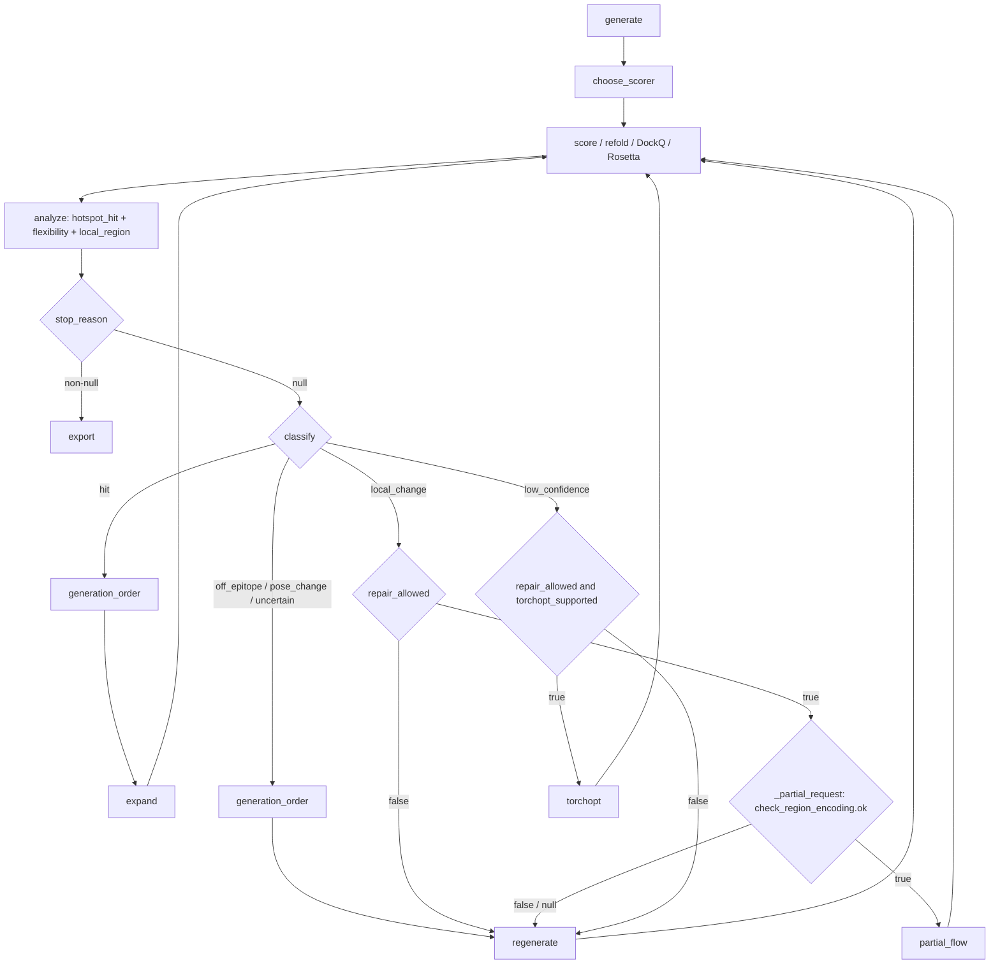

# Bounded feedback after an initial round

This prototype extends `protein-design initial-round` with automatic geometry
checks and a bounded feedback loop. It uses the existing PPIFlow, optional
TorchCraft, parallel AF3Score/TorchScore scoring tools, TorchFold and Rosetta services. The original single-round
workflow is unchanged unless the profile includes `autonomous`.

Copy a working initial-round profile, use a new run name, configure explicit
PPIFlow `specified_hotspots` (for example `C:4,C:10`), and add:

```yaml
autonomous:
  max_rounds: 3         # Follow-up rounds, in addition to the initial generation.
  max_samples: 100      # Includes initial generation and all follow-up requests.
  batch_size: 5
  max_batch_size: 20
  patience: 2
  rescue_limit: 3       # Low-score candidates refolded per batch for diagnosis.
  min_score: 0.8
  min_dockq: 0.49
  decision_policy: agent  # Uses the already configured default chat provider.
  decision_timeout: 120
```

Use the existing commands, mounted paths and service setup:

```bash
uv run --frozen ddeharness protein-design initial-round -c feedback.yaml --check
uv run --frozen ddeharness protein-design initial-round -c feedback.yaml
```

The detached `protein_initial_round_start` tool also accepts this profile. The
initial authorization covers its configured follow-up budget; no per-round human
confirmation is introduced. `--check` verifies the existing local inputs and
service contracts, not chat credentials, scientific validity or live inference.

## Evaluation and decisions

AF3Score and TorchScore are independent, parallel scoring tools. Select one
backend for a run; do not rename TorchScore outputs as AF3Score or combine their
scores. Explicit `evaluation.scoring_backend` takes precedence. Chat launch
reuses an existing configured scorer, or chooses the only registered scorer kind.
When both kinds are registered with no preference/configuration, AF3Score remains
the default. A unique registered alias supplies that kind's actual service settings.
The selection is fixed in the run snapshot; an API failure never switches scorers.

Let **S** be `af3score_iptm` or `torchscore_iptm` from the selected API.
A candidate qualifies when **S > 0.8 and design/refold DockQ > 0.49**, using
`autonomous.min_score` and `min_dockq`. At least one specified hotspot must also
be contacted. Rank by **100 * S - rosetta_interface_dg**, descending. Rosetta and
the selected scoring service are required. Missing scores are failures, never
zero. The default 0.8 is a prototype policy threshold, not evidence that the two
models' scores have identical calibration. Use separate runs for comparisons.

TorchFold ipTM remains available but is not an extra acceptance gate. The legacy
`min_refold_iptm`, scorer threshold and per-source refold limit do not override
feedback evaluation; the bounded rescue quota preserves some low-score candidates.



Every API operation in this diagram passes through the mandatory Slurm gateway.
The [executable predicate reference](decision-predicates.md) gives actual Python
functions, inputs, return values, formulas and error behavior. The agent receives
these measured results and legal options; it does not assign qualitative labels
from prose or invent residue masks.


The both-available/no-preference branch selects AF3Score. This is a legal-menu
policy, not a claim that its scores are superior. Expansion proposals are based
on existing hits; TorchCraft is omitted if not configured or incompatible.
Repair eligibility requires a candidate not previously repaired and with no
`parent_id`; current prototype descendants are not repaired again. The agent
chooses one legal option per round and may use other offered options; the edges
show proposal/default-rule grounds, not a free-form ability to invent requests.
Failed/missing candidate evaluations are recorded and excluded from the usable
pool. Uncertain submissions pause for recovery rather than issuing another POST.

| Evidence | Diagnosis | Legal next experiments |
| --- | --- | --- |
| Qualifying scores, hotspot contacted | Hit | Expand a compatible generator |
| No hotspot contacted | Off epitope | Regenerate |
| Low DockQ, stable framework, one changed design region | Local change | Partial flow if its exact request is available; otherwise regenerate |
| High DockQ but low selected-scorer ipTM | Low confidence | TorchOptimization for supported single-chain VHH/minibinders when registered; otherwise regenerate |
| Low DockQ without a localized repair region | Pose change | Regenerate |
| Missing hotspot mapping/geometry evidence | Uncertain | Bounded generator trials |
| Failed API/invalid structures | Evaluation failure | Record failure; never treat it as a biological low score |

Hotspot contact means any heavy-atom pair is closer than 5 Angstrom (configurable
`contact_distance`). Input PDB residue IDs, including insertion codes, are mapped
by sequence to the generated target and then through `refold_map`. Only an exact,
unique full-sequence or contiguous-crop mapping is accepted. TorchCraft's own
hotspot index convention is not guessed. Missing hotspots or ambiguous mappings
produce `unknown`; they cannot qualify as verified hits.

Target C-alpha coordinates are aligned with an iteratively trimmed stable core.
At least three non-collinear atoms and a majority stable core are required.
Binder coordinates are transformed with that same alignment, not independently.
A localized change requires framework RMSD <2 Angstrom and exactly one annotated
region RMSD >3 Angstrom. `framework_rmsd` and `region_rmsd` configure these prototype
thresholds. They identify differences, not proven mechanisms or binding affinity.

For automatic generator routing, local secondary structure is computed with
Biotite, without another model or external service. The hotspot neighborhood is
10 Angstrom in C-alpha distance. A loop fraction >=0.5 plus local target RMSD >2
Angstrom suggests trying TorchCraft; a loop fraction <0.3 and local RMSD <2 suggests
PPIFlow. Other cases remain unknown and alternate small compatible generator
trials. This is a structure-pair routing hint, not a measurement of dynamics.
No manual flexibility annotation is accepted.
Paired VH/VL never routes into an unsupported TorchCraft mode.

The agent receives measured evidence and a legal menu with fixed, validated
requests and bounded sample counts. It selects an option and explains why. It
cannot invent paths, mutation masks, modes or larger budgets. An unavailable
provider, timeout or invalid selection records a fallback and uses deterministic
rules. `decision_policy: rules` runs offline without a chat provider. Workers
poll scientific services themselves, without repeated model calls.

## Automatic partial-flow parameters

No extra human region input, generator annotations, repair template or candidate manifest
fields are required. Each candidate retains its validated `generation_request`.
Decisions use only registered tool arguments, existing API results and local
Python calculations. Arbitrary `design_regions` or `partial_requests` fields in
generator responses are not used.

1. If the existing PPIFlow request supplies `cdr_position`, parse its CLI ranges
   (for example `A26-33,A51-58,B91-100`) against the actual generated PDB residue
   IDs. Preserve `fixed_positions` (for example `A98-110`) and exclude them from
   all repair selections. Missing or ambiguous residue IDs make repair unavailable
   for that candidate; the worker does not ask for a replacement mask.
2. If no CDR selection was supplied, Python aligns the structures, calculates
   per-residue displacement and identifies contiguous coil residues displaced by
   more than the region threshold. Coil assignments use Biotite's local secondary
   structure calculation. At least three binder residues and a majority of the
   binder must remain outside the proposed repair regions. These automatically
   located segments are **geometric loop regions**, not asserted IMGT/CDR labels.
3. A local repair requires a stable remaining binder core and exactly one changed
   region. Python converts the selected sequence positions back to the candidate's
   actual PDB residue IDs. It sends that region as `cdr_position` and freezes every
   other binder residue using `fixed_positions`. Explicit input fixed positions
   always take precedence. Ambiguous insertion codes are not silently renumbered.
4. Copy chain IDs, hotspots, model configuration, weights and timestep arguments
   from the saved registered PPIFlow request. Reuse its `start_t` if present;
   otherwise the prototype uses `0.01`. The worker sets the current candidate's
   `complex_pdb`, a fresh name/output directory and a one-sample repair budget.
5. Validate the resulting `partial_antibody` / `partial_nanobody` request using
   the existing registered schema, submit, then repeat the selected scorer, TorchFold, DockQ
   and Rosetta evaluation. Check that target sequences and all binder residues
   outside the selected region remain unchanged.

Only the PPIFlow CLI range form shown in the registered-tool examples is decoded;
unknown dictionary/list mask semantics are not guessed. Input residue ranges are
interpreted as candidate PDB residue IDs, while internal region indices are
one-based sequence positions. The actual deployed partial-flow API must support
that CLI convention. Full-generation `cdr_length` intervals alone are not exact
CDR boundaries and are not used to invent boundaries.

A parent is repaired at most once; repair children are not repaired again. If
Python cannot obtain a valid local selection or the service does not support the
binder mode, the worker automatically continues with bounded generation, without
asking for human annotations or new tool arguments.

## Recovery, outputs and limitations

Each follow-up decision reserves its samples and persists the exact request
before submission. Existing checkpointed task IDs are reused on resume; uncertain
submissions retain the existing reconciliation behavior instead of reposting.
Generated/refold structures are retained in candidate-specific snapshots, and
hashes are checked on resume. Earlier accepted candidates are retained even if
later attempts are worse. `parent_id` records repair provenance or the hit that
motivated global expansion; expansion itself is not conditioned on that sequence.

`decisions.json` contains actions, reasons, fallback status, reserved samples and
stop reason. `candidates.json` adds geometry diagnostics and lineage;
`ranking.csv` adds `ranking_score`. `summary.json` reports rounds and sample usage.
The loop stops at the follow-up round limit, total sample limit, or two consecutive
rounds with neither a new accepted sequence nor a higher best ranking score.
Duplicates are detected within each source/batch; no structural clustering or
budget-learning algorithm is added.

TorchOptimization is available when its existing registered service is present.
The natural-language launch tool automatically reuses a unique `torchopt`
registration; no extra scientific input is requested. CLI profiles can likewise
reuse that service under `evaluation.torchopt`. An ambiguous/missing registration
or unsupported paired-chain binder leaves the action out of the legal menu.
The API verifies Slurm completion and exposes native final PDBs. The runner
imports one deterministic valid final structure per repair slot, retains all
native artifact paths in the checkpoint, and re-runs the usual scoring workflow.
The admitted file is not claimed to be the optimizer's globally best structure.
Default feedback uses one MCMC round/proposal, one ddG round, one shard and one
GPU; normal registered calls retain native defaults. Any existing
`evaluation.torchopt_options` supply other registered controls such as method,
partition and rescue thresholds. Unknown receipts, missing output files or
unverified child-job completion never produce fabricated success.

No new prediction model, weight download, live inference validation or guarantee
of improved experimental affinity is introduced. DockQ measures consistency with
the generated design pose, not accuracy against an experimental native complex.


## Chat launch and API lifetime

YAML is optional: the chat agent may supply `run_config` directly to
`protein_initial_round_start`, using the same inputs and validation. The worker
saves the structured run configuration automatically. See the
[natural-language launch and API cleanup guide](automatic-initial-round.md#natural-language-launch-without-a-yaml-file).
Owned sbatch APIs are released after the complete feedback workflow finishes and
all inference jobs are terminal; they remain available between follow-up rounds.
