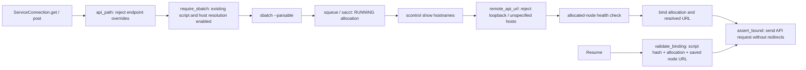

# Executable feedback predicates

All decision inputs come from registered request arguments, API metrics or local
Python geometry calculations. No human flexibility label or extra region
annotation is required. These functions are called by the actual router, not
pseudocode disconnected from execution.

## Function map

| Diagram node | Python entry point | Output / decision |
| --- | --- | --- |
| Scoring tool | `policy.choose_scorer(explicit, configured, registered)` | Explicit choice wins; configured/sole registered TorchScore selects TorchScore; otherwise AF3Score |
| Hotspot contacted | `policy.hotspot_hit(contacts, cutoff=5.0)` | Any minimum heavy-atom distance <5 Å; empty evidence is `None`, not `False` |
| Neighborhood evidence | `policy.flexibility(loop_fraction, local_rmsd, motion_threshold=2.0)` | `flexible` if fraction >=0.5 and RMSD >2 Å; `rigid` if fraction <0.3 and RMSD <2 Å; otherwise `unknown` |
| Local problem | `policy.local_region(core_rmsd, region_rmsds, core_count, total_count)` | Exactly one region >3 Å, remaining core <2 Å with at least three residues and >=half the binder; otherwise `None` |
| Quality class | `diagnostics.classify(metrics, evidence, options, score_metric)` | `hit`, `off_epitope`, `uncertain`, `local_change`, `pose_change`, `low_confidence`, `evaluation_incomplete` |
| Repair eligibility | `policy.repair_allowed(candidate, repaired)` | Candidate not already repaired and has no `parent_id` |
| Region encodable | `regions.check_region_encoding(atoms, selections)` | `{"ok": true, "encoded": "A26-33", "reason": null}` or `ok=false` with a reason |
| Partial request valid | `autonomous._partial_request(...)` | Existing registered PPIFlow schema validates computed masks and inherited parameters; returns request or `None` |
| TorchOpt supported | `policy.torchopt_supported(chains, mode, registered)` | Registered service, compatible VHH/minibinder mode, one binder/target, one-character IDs |
| Generator preference | `policy.generation_order(available, best_flexibility, used)` | Flexible -> TorchCraft first; rigid -> PPIFlow first; unknown -> fewer prior uses; absent generators omitted |
| Stop | `policy.stop_reason(round_index, used_samples, stale_rounds, options)` | `max_rounds`, `sample_budget`, `no_improvement`, or `None` |

Modules live under `opendde_harness.plugin.protein_design.initial_round`.
`diagnostics.analyze(runner, candidate)` reads retained structures and computes:

- Input hotspot IDs -> unique target sequence mapping -> refold chain mapping.
- Minimum heavy-atom contact distances; ambiguous mappings remain unknown.
- Stable-target-core alignment and binder/region C-alpha deviations using that fit.
- Biotite secondary structure within a 10 Å C-alpha neighborhood of the hotspots;
  the coil fraction and target displacement feed `flexibility`.
- Regions from existing `cdr_position` / `fixed_positions`, or Python-computed
  displaced coil runs when those arguments are absent.

`check_region_encoding` converts one-based internal sequence positions back to
actual PDB residue IDs. Empty selections, missing coordinates, insertion-coded
ambiguity, invalid ranges or unsupported chain IDs cannot yield a valid mask.
Explicit fixed positions always win. A short direct example using computed data:

```python
from opendde_harness.plugin.protein_design.initial_round.policy import (
    hotspot_hit, flexibility, local_region,
)

hit = hotspot_hit([{"distance": 4.2}, {"distance": 6.0}])  # True
route = flexibility(loop_fraction=0.7, local_rmsd=3.1)    # flexible
region = local_region(1.1, {"H1": 0.8, "H3": 4.2}, 90, 110)  # H3
```

The values in that example are illustrative; production uses measured Python
results. Flexibility is a routing hint, not measured physical dynamics. The agent
chooses from the computed legal menu; each selected action records its `basis`,
request, reason and reserved budget in `decisions.json`.

## Mandatory Slurm gateway



This gateway applies to registered PPIFlow, TorchCraft, AF3Score, TorchScore,
TorchFold, Rosetta and TorchOptimization calls, including status, results,
metrics, cancellation and submission reconciliation. Each API starts lazily;
existing verified allocations are reused within the same workflow. A new HTTP
request does not imply a new sbatch job. Port/protocol/prefix come from the
registration, while the actual hostname comes only from Slurm.

There is no direct-HTTP fallback, no `sbatch_resolve_host=false` mode and no
localhost probe. Unbound clients start with a non-routable placeholder host.
Absolute/protocol-relative API paths and redirects cannot change the allocated
endpoint. Registry discovery/`--check-health` and workflow `--check` do not submit
jobs or probe a port. Missing scripts fail before inference rather than starting
local API processes. URL examples use `slurm-api.invalid` as a placeholder and
must have the existing deployment's absolute sbatch script.

The control host must already have scheduler access and the shared filesystem.
Local geometry/DockQ subprocesses are analysis tools, not local HTTP inference
servers. The chat provider and the legacy separate compute workflow are outside
this scientific API gateway. Real cluster networking/GPU execution is not claimed
by the scheduler/HTTP simulation tests.
